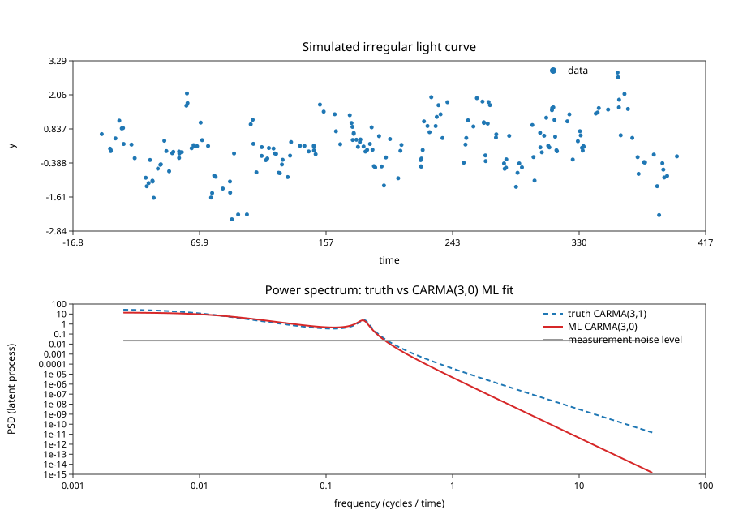

# carma-reimpl

A minimal reimplementation of CARMA(p, q) models for irregularly sampled
time series (Kelly et al. 2014, [arXiv:1402.5978](https://arxiv.org/abs/1402.5978)).

At this stage Kalman-filter likelihood, simulation, multi-start maximum likelihood, and
AICc order selection are implemented. There is no MCMC (Markov chain Monte Carlo), prediction, or diagnostics yet.

## Install and run

```bash
pip install -e .            # needs numpy and scipy only
python examples/demo.py     # fits CARMA(p,q), writes docs/demo_fit.svg (~2 min)
python -m unittest discover -s tests -v
```

## Result (demo)

Simulated CARMA(3,1) light curve, 200 irregular times, noise sd 0.15, seed 42.
Fits use 8 random starts each.

| p | q | NLL | AICc |
|---|---|---|---|
| 1 | 0 | 183.37 | 370.81 |
| 2 | 0 | 176.91 | 359.94 |
| 2 | 1 | 176.91 | 362.02 |
| 3 | 0 | 147.30 | 302.80 |
| 3 | 1 | 147.22 | 304.76 |
| 3 | 2 | 147.30 | 307.03 |

AICc selects CARMA(3,0). The true model, CARMA(3,1), is within 0.08 in NLL and 2 in AICc.
The MA term is weak in this realization, so the ML fit can't reliably tell the two apart.



## What is implemented

- `carma_reimpl/model.py`: roots from log-quadratic coefficients (paper Eq. 30), MA coefficients
  with beta_0 = 1, ACVF (Eq. 4), PSD (Eq. 3), Kalman log-likelihood in the rotated basis
  (Appendix A), dense reference likelihood, and exact simulation by Cholesky.
- `carma_reimpl/fit.py`: multi-start L-BFGS-B fit per (p, q) and AICc.
- `carma_reimpl/svgplot.py`: minimal SVG line and point plots.

Checks in `tests/`: CAR(1) ACVF and PSD closed forms, ACVF against the Fourier transform of
the PSD, and Kalman vs dense likelihood for CARMA(3,1) and CAR(1), with nu = 1 and nu = 1.3.

## Simplifications (v1)

- The mean `mu` is fixed to the sample mean. The measurement-error scale `nu` is fixed to 1.
  The AICc parameter count is therefore `k = 1 + p + q`, not the paper's `3 + p + q`.
- No priors, no bounds beyond numerical guards, no ordering constraint on roots.
  Multi-start fits can land on different roots; check the starts that succeed.
- Dense simulation is O(n^3), so it is for small n only.
- No ZCAR/ZCARMA parameterization.

## Not yet

MCMC (RAM with parallel tempering), priors and constraints, interpolation/forecasting,
posterior summaries and ESS, residual diagnostics, and a real data example.

## License

 GNU General Public License v3.0 or later
